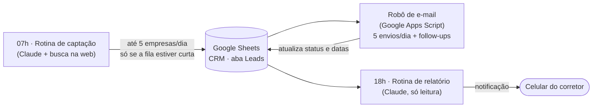

# Prospecção PME com IA

Sistema de prospecção B2B para corretores de **planos de saúde empresariais (PME)**. Uma IA (Claude) pesquisa empresas brasileiras com perfil de compra, valida o e-mail publicado e alimenta uma planilha-CRM no Google Sheets. Um robô em Google Apps Script faz os envios com limite diário, e no fim do dia a IA manda um relatório do funil para o celular.

> Projeto construído com Claude (Cowork) + Zapier + Google Sheets. Sem servidor, sem banco de dados, sem custo de infraestrutura.

## Como funciona



| Etapa | Quem faz | Quando | O que faz |
|---|---|---|---|
| Captação | Claude (rotina agendada) | Seg–sex, 07h | Lê a planilha, confere a fila, pesquisa empresas novas e grava até completar 5 na fila |
| Envio | Google Apps Script | Gatilho do próprio script | Envia o 1º e-mail e os follow-ups, respeitando o limite diário da aba Config |
| Relatório | Claude (rotina agendada) | Seg–sex, 18h | Resume envios do dia, respostas, descadastros, erros e próximo passo |

## Regras de qualificação de leads

A rotina de captação só aceita uma empresa se **todas** as condições forem verdadeiras:

- Empresa privada com **30+ funcionários CLT** (faixa ideal: 30 a 500)
- Setores com equipe operacional: indústrias, metalúrgicas, transportadoras, construtoras, distribuidoras, redes regionais de varejo, facilities, call centers, agroindústrias, frigoríficos, gráficas, engenharia
- E-mail **publicado** no site oficial ou em diretório empresarial. Nunca deduzido ("contato@dominio" sem ter visto publicado é descartado)
- Domínio próprio da empresa. Descarta Gmail/Hotmail/Outlook/UOL/BOL/Terra/Yahoo e e-mails de escritórios de contabilidade
- Sem duplicidade de nome ou e-mail com o que já está na planilha

Fica de fora: escolas, ONGs, fundações, associações, órgãos públicos, MEI e empresas com menos de 30 funcionários.

## Ritmo de envio (conta nova)

Para proteger a reputação do remetente, o sistema trabalha com **fila curta**:

- O robô envia no máximo **5 e-mails por dia** (configurável na aba Config)
- A captação só adiciona empresas quando a fila de status `Novo` tem menos de 5
- Resultado: nunca há centenas de leads esperando, e o volume pode subir aos poucos

Veja [docs/entregabilidade.md](docs/entregabilidade.md) para o checklist completo (SPF/DKIM/DMARC, aquecimento, bounces e LGPD).

## Estrutura do repositório

```
prompts/
  captacao-leads.md       Prompt da rotina diária de captação (07h)
  relatorio-diario.md     Prompt da rotina diária de relatório (18h)
docs/
  planilha.md             Estrutura das abas Leads e Config e ciclo de status
  entregabilidade.md      Checklist de entregabilidade e LGPD
  instalacao.md           Passo a passo para montar o sistema
config/
  agendamentos.json       Horários (cron) das rotinas
  variaveis.example.env   Variáveis a preencher (IDs da planilha e conexão)
exemplos/
  leads-exemplo.csv       Planilha de exemplo com dados fictícios
```

## Tecnologias

- **Claude (Cowork)**: rotinas agendadas com pesquisa na web e subagentes
- **Zapier MCP**: leitura e escrita no Google Sheets (`GoogleSheetsV2CLIAPI`)
- **Google Sheets**: CRM e fila de envio
- **Google Apps Script**: robô de envio (não incluído neste repositório)

## Licença

MIT. Veja [LICENSE](LICENSE).
