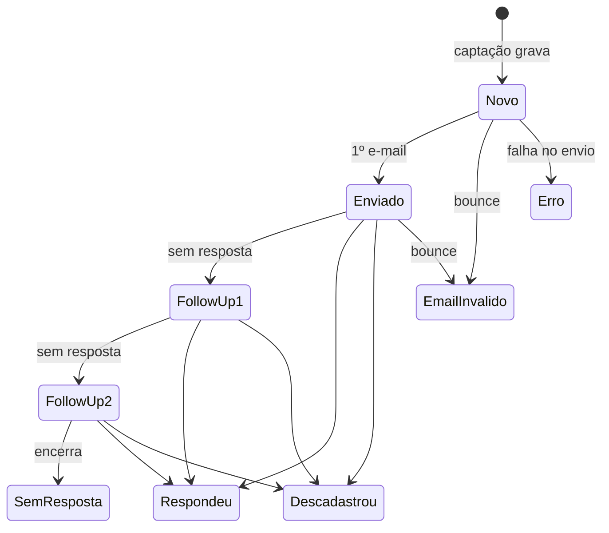

# Estrutura da planilha "CRM Prospecção"

## Aba `Leads`

| Coluna | Campo | Quem preenche | Exemplo |
|---|---|---|---|
| A | Empresa | Captação (IA) | Metalúrgica Exemplo Ltda |
| B | Contato (nome) | Manual, opcional | Maria Souza |
| C | E-mail | Captação (IA) | contato@metalurgicaexemplo.com.br |
| D | Cidade | Captação (IA) | Joinville/SC |
| E | Setor | Captação (IA) | Metalúrgica |
| F | Vidas (aprox.) | Captação (IA) | 120 |
| G | Status | Captação → Robô | Novo |
| H | 1º e-mail em | Robô | 18/11/2026 |
| I | Follow-up 1 em | Robô | 21/11/2026 |
| J | Follow-up 2 em | Robô | 26/11/2026 |
| K | Última verificação | Robô | 26/11/2026 |
| L | Observações | Captação / Robô | Fonte: metalurgicaexemplo.com.br/contato |

A coluna L sempre registra **onde o e-mail foi encontrado** (`Fonte: ...`), para auditoria e para conferir em caso de bounce.

## Aba `Config`

| Célula | Campo | Exemplo |
|---|---|---|
| A2:B2 | Robô ativo | SIM |
| A3:B3 | Modo teste | NÃO |
| A4:B4 | E-mail de teste | seu-email@exemplo.com |
| A5:B5 | Limite diário | 5 |

## Ciclo de status

Valores aceitos na coluna G: `Novo`, `Enviado`, `Follow-up 1`, `Follow-up 2`, `Respondeu`, `Sem resposta`, `Descadastrou`, `E-mail inválido`, `Erro`.
